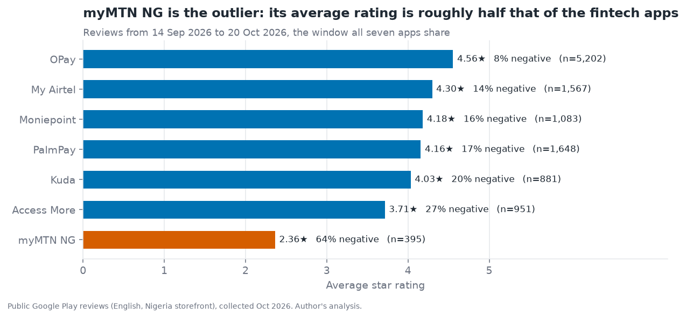
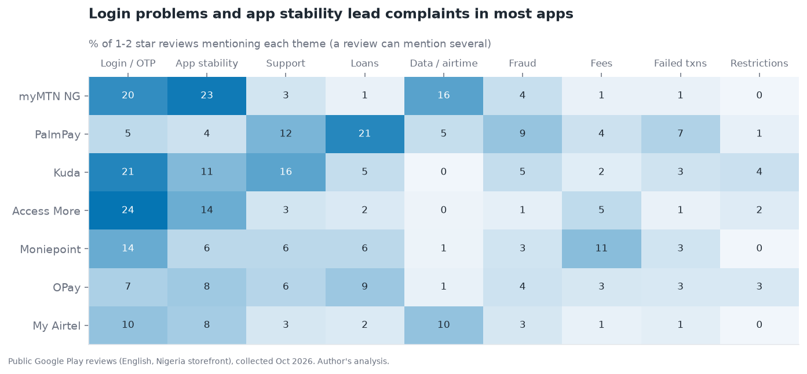
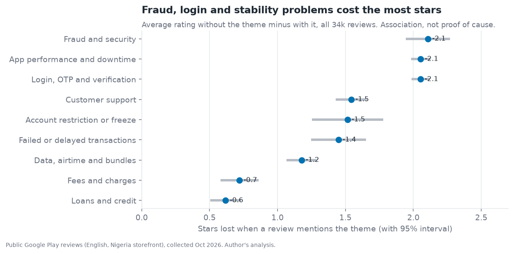
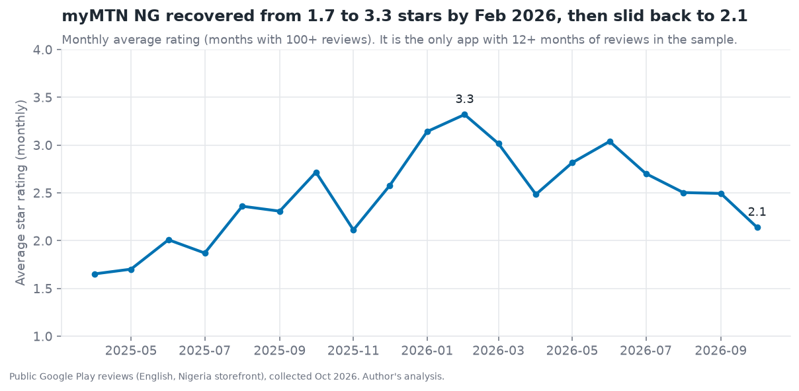

# Voice of the Nigerian Customer: App Review Analysis

> What do customers of Nigerian fintech, bank and telecom apps complain about, and which problems cost the most stars? An analysis of **34,000 public Google Play reviews across 7 apps** with a transparent, audited theme classifier and a ranked fix list for each app.

**Author:** Emmanuel Omowumi · [LinkedIn](https://www.linkedin.com/in/emmanuel-omowumi-98bb03139/) · emmanueloluwatobi2015@gmail.com
**Audience:** product, customer-experience and operations leads at banks, fintechs and telcos.



## Key findings

| # | Finding | Evidence |
|---|---|---|
| 1 | **myMTN NG is the outlier.** | Over the window all seven apps share (14 Sep to 20 Oct 2026): 2.36★ and 64% negative, vs 3.7★ to 4.6★ for the other six. (n=395, so treat the exact figure with care.) |
| 2 | **Getting into the app is the number one complaint.** | Login, OTP and verification problems appear in 17.5% of all 1-2★ reviews; app crashes, slowness and downtime in another 14.5%. |
| 3 | **Money-movement failures are a small share of what people write.** | Failed or delayed transactions are about 2% of negative reviews. Customers mostly complain that they cannot get in or that the app is unstable. |
| 4 | **Fraud, login and stability problems cost the most stars.** | Reviews mentioning them rate about 2.1, 2.05 and 2.05 stars lower than reviews that don't. Fees and loans cost under 0.8. |
| 5 | **Each app has its own pain point.** | PalmPay: loans (21% of its negatives). Kuda: support (16%). Access More: login (24%). myMTN NG: stability (23%) and data/airtime (16%). Moniepoint: fees (11%). |
| 6 | **myMTN NG's rating swings with releases.** | Monthly average rose from 1.7★ (Apr-May 2025) to 3.3★ (Feb 2026), then slid back to 2.1★ (Oct 2026). Version 2.0.12 averaged 1.59★, 0.83 below the app's mean (401 reviews). |



| | |
|---|---|
|  |  |

## Ranked fix list per app

Priority = share of the app's 1-2★ reviews mentioning the theme × the star penalty of that theme. Full table: [`results/fix_list.csv`](results/fix_list.csv).

| App | #1 | #2 | #3 |
|---|---|---|---|
| myMTN NG | Login / OTP (22%) | App stability (21%) | Data & airtime (11%) |
| Access More | Login / OTP (21%) | App stability (14%) | Customer support (4%) |
| Kuda | Login / OTP (18%) | Customer support (15%) | App stability (9%) |
| PalmPay | Fraud & security (9%) | Customer support (12%) | Login / OTP (8%) |
| My Airtel | Login / OTP (11%) | App stability (9%) | Data & airtime (13%) |
| Moniepoint | Login / OTP (10%) | App stability (6%) | Fees (12%) |
| OPay | App stability (9%) | Login / OTP (7%) | Customer support (6%) |

Percentages are the share of that app's 1-2★ reviews that mention the theme.

## Recommendations

1. **Treat onboarding and login as a funnel with an owner.** Track OTP delivery rate, face/BVN/NIN verification pass rate and time-to-first-login, and alert on drops. This is the top-ranked fix in five of the seven apps.
2. **Add a fallback for OTP and biometric failure** (call-back, in-branch or agent verification) so a failed SMS does not lock a customer out for weeks.
3. **Use staged rollouts and release health checks.** For myMTN NG, individual versions moved the rating by up to 0.8★; watch the rating and crash rate by version in the first 72 hours.
4. **Fix support responsiveness at Kuda and PalmPay,** where customer support is 12-16% of complaints.
5. **For telcos, separate app problems from network problems** in review tagging, since customers use the app score to vent about the network.

## How it works

1. **Collect** ([`src/scrape.py`](src/scrape.py)): public English reviews from the Nigerian Play Store storefront, newest first, up to 8,000 per app. Only text, star rating, date, app version and thumbs-up are kept; reviewer names, IDs and avatars are dropped.
2. **Clean** ([`src/clean.py`](src/clean.py)): scrub phone numbers, emails and long digit strings; drop reviews under 12 characters and duplicates (56,000 collected → 33,992 kept).
3. **Tag themes** ([`src/themes.py`](src/themes.py)): nine transparent regular-expression themes for Nigerian English (OTP, BVN, NIN, PND, "debited but", and so on). No black box: anyone can read and change the rules.
4. **Analyse** ([`src/analyze.py`](src/analyze.py)): theme prevalence, rating penalty with 95% intervals, monthly trends, spike detection, version effects, ranked fix list.

### Audit of the theme rules

A first audit caught false positives: "login failed" was counted as a failed payment, and "token" (electricity tokens) as a login problem. Both rules were tightened and re-audited. On 25 random 1-2★ matches per theme, my manual precision check found:

| Theme | Relevant matches | Precision |
|---|---|---|
| Login, OTP and verification | 24 of 25 | ~96% |
| Failed or delayed transactions | 19 of 25 | ~76% |
| App performance and downtime | 18 of 25 | ~72% |

This is a single-reviewer audit of a small sample, so read these as rough guides. **Recall is lower:** only 47% of 1-2★ reviews match any theme, so shares are a floor, not the full picture of complaints.

## Limitations

- **Different time windows per app.** The 8,000 newest reviews cover about 5 weeks for OPay but 18 months for myMTN NG. Cross-app comparisons use the shared 14 Sep to 20 Oct 2026 window; trends are shown only for myMTN NG, the one app with a long history.
- **Small samples in the shared window** (395 to 5,202 reviews per app); intervals are wide for the smaller ones.
- **Self-selected reviewers.** People who write reviews skew toward extremes, so ratings are not a satisfaction score for all customers.
- **Association, not causation.** The rating penalty shows that reviews mentioning a theme rate lower; it does not prove the theme caused the rating.
- **Rule-based themes** miss paraphrases and Pidgin variants, and star ratings are sometimes mismatched with the text.
- **My Airtel is a multi-country app,** so some reviews may not come from Nigerian customers even with the Nigeria storefront filter.
- **Telecom apps** receive reviews about the network itself, not just the app.

## Data and ethics

The raw reviews are **not included** in this repo. Google Play's terms may restrict scraping, so check them before re-running the collection and keep the request rate low. The repo publishes the code and aggregated results ([`results/`](results)) only. Personal identifiers are removed at collection and cleaning, and this README paraphrases themes rather than quoting reviewers.

## Reproduce

```bash
pip install -r requirements.txt
python src/scrape.py        # collects public reviews into data/raw (git-ignored; takes a while)
python src/clean.py
python src/analyze.py       # writes results/*.csv and results/summary.json
python src/make_figures.py
pytest -q                   # 17 tests (rules, PII scrubbing, cleaning, statistics); needs no raw data
```

## Skills demonstrated

| Skill | Evidence |
|---|---|
| Data collection and ethics | Minimal-field collection, PII scrubbing, no redistribution of raw text |
| Text analytics | Domain-specific, auditable classifier with a documented precision check |
| Statistics | Rating penalties with 95% intervals; per-app spike detection; sample-size rules |
| Analytical honesty | Mismatched windows handled, recall and sampling limits stated |
| Business communication | Ranked fix list per app and recommendations tied to evidence |
